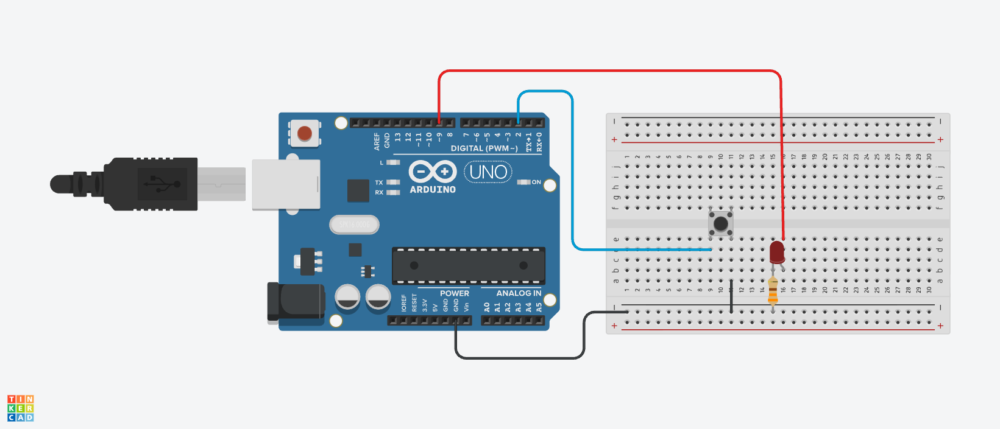

# Component Lab: Pushbutton
In this lab, you will learn how to use a pushbutton as a digital input. You will then be able to trigger reactions in your Arduino by providing user-driven input to the system. 

In this case, pushing the button causes the Arduino to light an LED.

## 1. Understand the push button
Pushbuttons typically have four legs, with each pair of legs on the same side electrically connected. When the button is not pressed, a gap prevents electricity from flowing between the two sides. Pressing the button closes the circuit, allowing electricity to flow. Depending on how the circuit is wired, the Arduino reads this as either a HIGH or LOW signal.

## 2. Build the circuit
You will need the following components:
- Arduino Uno R3
- Breadboard
- Pushbutton
- LED
- 330Ω resistor
- Jumper wires

### Wiring
| Component |	Arduino connection |
| --- | --- |
| Pushbutton (one side)	| Digital pin 2 |
| Pushbutton (opposite side)	| GND |
| LED anode (+)	| Digital pin 9  |
| LED cathode (−)  |	GND through 330Ω resistor |

**Note:** On the LED it doesn't matter whether the resistor goes on the anode or cathode end.

Use the following image to guide your setup.

## 3. Investigate
Upload your pushbutton.ino code to the Arduino and run it. Open the Serial monitor.

When we configure the button pin using INPUT_PULLUP, the Arduino activates an internal pull-up resistor that keeps the pin at a stable HIGH signal when the button isn't pressed. Without this resistor, the input pin would be floating, meaning it could unpredictably read HIGH or LOW. When the button is pressed, it connects the pin to GND, causing the Arduino to read LOW.

1. What happens to the LED when you push the button?
    > your answer

2. What values appear in the Serial monitor when you press and hold down the button?
    > your answer

3. Why does LOW indicate that the button is pressed?
    > your answer

## 4. Modify the behavior
Modify the code so that 
1. the LED is *on* when the button is not pushed and *off* when it is pushed.
2. the LED blinks every 250 milliseconds when the button is held
3. pressing the button *toggles* the LED between on/off. The LED should stay in its new state after the button is released.
4. Challenge: a twist on number 3 - figure out how to detect a new press rather than checking if it's being pushed.

## 5. Wrap-up
1. How is a digital input different from a digital output?
    > your answer

2. Why might a physical computing system need to remember the previous state of a button?
    > your answer

3. Identify one way a pushbutton could improve your final Interactive Systems project.
    > your answer
